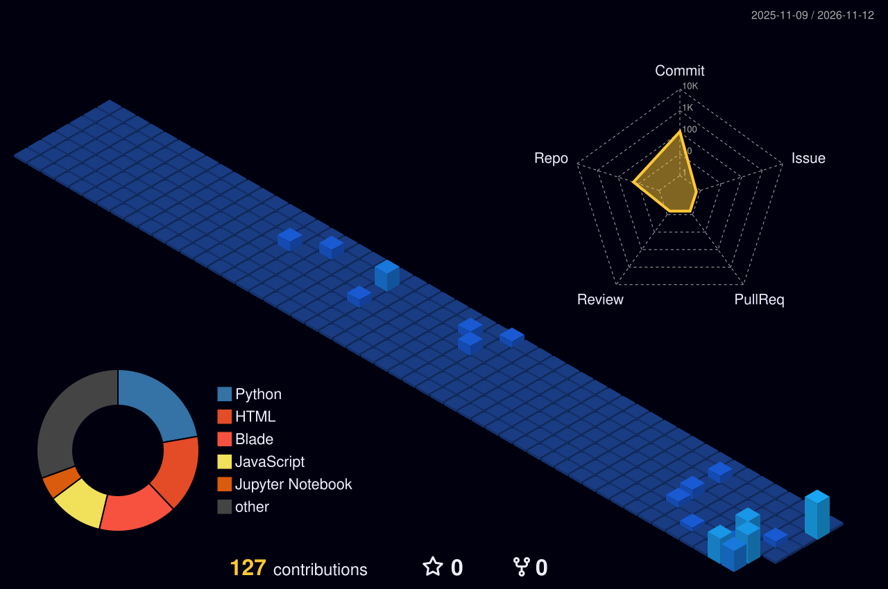

 

 

 

### ✦ Featured builds

| Project | What it is | Stack |
|---|---|---|
| [**presensi-flutter**](https://github.com/des1susanti/presensi-flutter) | Android attendance app with geofencing, fake-GPS detection & face verification | Flutter · Dart · Firebase |
| [**robot-gestur**](https://github.com/des1susanti/robot-gestur) | Gesture-controlled marionette robot | Python · OpenCV · MediaPipe |
| [**mitologi-nusantara**](https://github.com/des1susanti/mitologi-nusantara) | Hand-gesture webcam app featuring Indonesian mythological creatures in a 3D cube | Python · Computer vision |
| [**etl-sap-icrm-supply-chain**](https://github.com/des1susanti/etl-sap-icrm-supply-chain) | Web-based ETL & data reconciliation for SAP and iCRM+ inventory sync | Laravel 11 · Python |
| [**portofolio-v2**](https://github.com/des1susanti/portofolio-v2) | Interactive 3D portfolio — a little robot walking around a mini campus | Three.js · JavaScript |
| [**life-design-quest**](https://github.com/des1susanti/life-design-quest) | Interactive career-design game inspired by *Designing Your Life* | HTML · JavaScript |

### ✦ Contribution landscape

 

 

